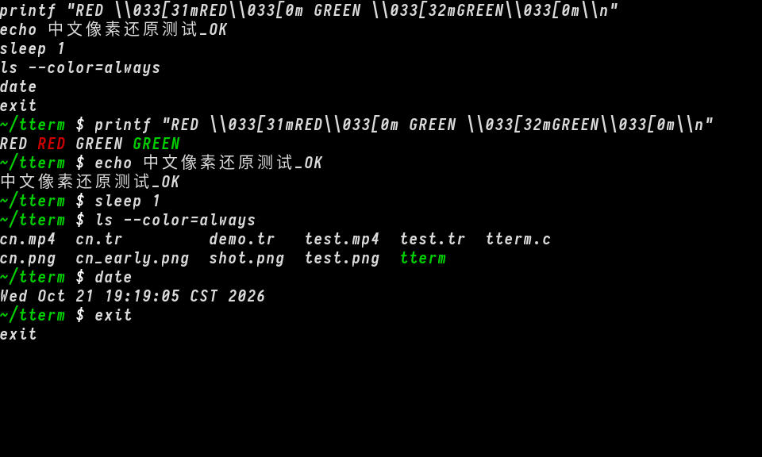
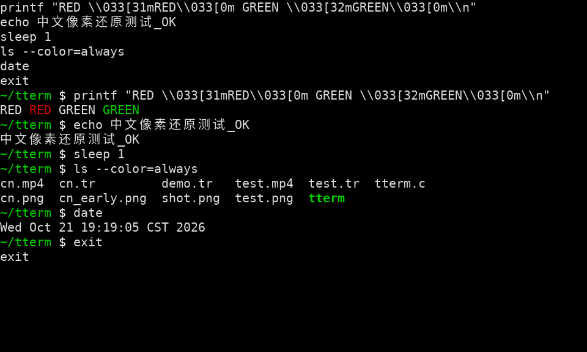

# tterm

Record, replay, and render terminal sessions as PNG/MP4 on Termux.

## Features

- Record terminal sessions via PTY (`rec`)
- Replay recordings with playback speed control (`play -x`)
- Render a single frame to PNG with font control (`shot -F`)
- Render full recordings to MP4 with speed control (`video -x`)
- Live capture to MP4 (`video -l`)
- Glyph caching + dirty-frame skipping for better performance
- Proper terminal state restore on exit (raw mode, cursor, alternate screen)
- Font resolution: `TTERM_FONT` → `~/.termux/font.ttf` → system font

## Screenshots





## Build

```bash
pkg install clang make pkg-config freetype libpng ffmpeg
make
```

## Usage

```bash
./tterm rec -o session.tr
./tterm shot session.tr -o frame.png -F ~/.termux/font.ttf
./tterm play session.tr -x 2
./tterm video session.tr -o out.mp4 -f 15 -x 2
./tterm video -l -o live.mp4 -f 15 -F ~/.termux/font.ttf
```

## Notes

- Requires `ffmpeg` with `libx264` for `video` output
- Best with a Nerd Font for icons/glyphs
- On Termux, put your font at `~/.termux/font.ttf` to be auto-detected
